# MCP Inspector with Conformance Checks: User Guide

This guide shows you how to use a fork of the MCP Inspector that adds a **Conformance** tab. You can point it at any MCP server. It covers starting the Inspector, adding a server, sending an API key or other headers, using the Tools tab, and using the Conformance tab to find schema problems before your users do.

**Who this is for:** developers who build MCP servers, and testers who check them.

**A few terms first:**

- **MCP (Model Context Protocol):** the protocol AI clients use to talk to tool servers. A server publishes *tools*, and a client calls them.
- **JSON Schema:** a standard way to describe what a JSON value must look like, for example "an object with a required `name` that is a string". MCP uses JSON Schema 2020-12.
- **inputSchema:** the JSON Schema for a tool's arguments.
- **outputSchema:** an optional JSON Schema that describes what a tool returns.
- **structuredContent:** the machine-readable JSON object a tool returns. If a tool declares an `outputSchema`, its `structuredContent` must match it.
- **Strict client:** a client that checks every `structuredContent` against the `outputSchema` and rejects the whole response if anything is off. The official Python MCP SDK works this way.

## 1. Why the Conformance tab exists

The stock Inspector can show a tool result as fine even though a strict client would reject it. There are two reasons:

1. **It honors OpenAPI `nullable`.** The stock Inspector checks results with Ajv, a JavaScript validator that understands `nullable: true`. That keyword comes from OpenAPI, and JSON Schema 2020-12 ignores it. So a field declared `{"type": "string", "nullable": true}` that comes back as `null` passes in the stock Inspector, but the Python SDK rejects it.
2. **It mislabels response problems.** When a result does not match its output schema, the stock Tools tab shows **Tool Call Failed / Invalid Parameters** and says *"The server rejected this call with -32602 (Invalid params). Check the argument values against the tool's schema."* The server did not reject anything, and your arguments were fine. The problem is in the server's **response**.

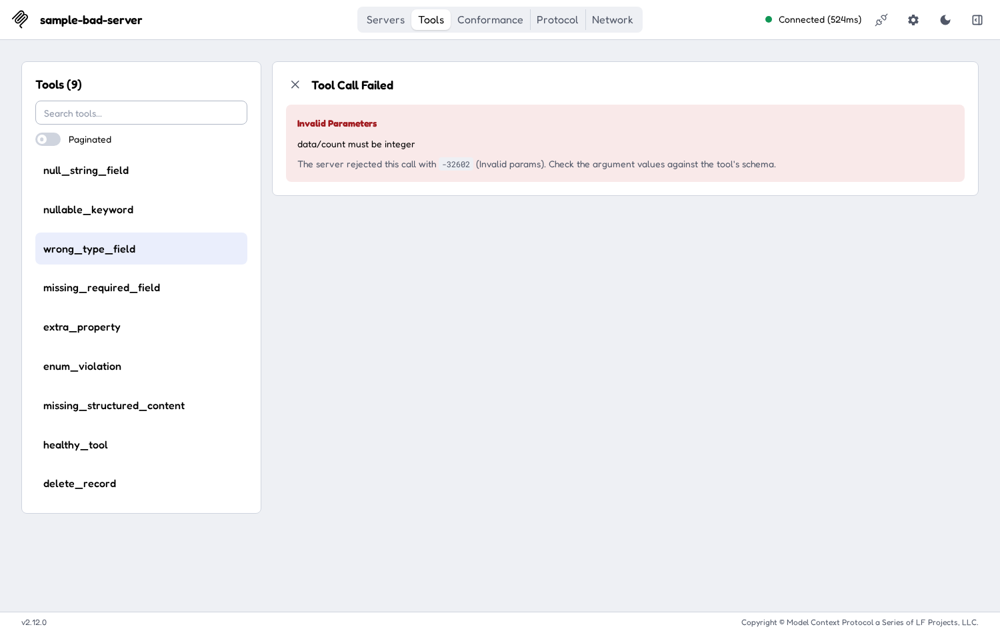

The Conformance tab checks every result the way a strict client does (JSON Schema 2020-12, `nullable` ignored). It explains each problem in plain words: what was expected, what came back, where (the JSON path), and how to fix it.

> **Important:** the Conformance tab checks the **shape** of responses only: types, required fields, allowed values and so on. It does not check whether the data is correct. A tool that returns the wrong customer with the right shape will pass.

## 2. Install and start

These steps assume you unzipped the package and opened a terminal in its top folder, the one that contains `mcp-inspector-fork/`, `mcp-check/` and `guide/`.

### 2.1 What you need

- **Node.js 22.19 or newer** (with npm). The Inspector's `package.json` requires `>=22.19.0`. Check with `node --version`.
- **Python 3.10 or newer**, for `mcp-check` and the sample server. Check with `python3 --version`.
- **Chrome** or another current browser.

### 2.2 First-time install

1. Install the Inspector's dependencies. This can take a few minutes:

   ```bash
   cd mcp-inspector-fork
   npm install
   cd ..
   ```

   Run `npm install` in `mcp-inspector-fork`, not in `clients/web`. It installs the shared code and then every client, including the web client.

2. Set up `mcp-check`, which also contains the sample server:

   ```bash
   cd mcp-check
   python3 -m venv .venv
   .venv/bin/pip install -r requirements.txt
   .venv/bin/pip install -e .
   cd ..
   ```

   On Windows, use `.venv\Scripts\pip` instead of `.venv/bin/pip`.

You only need to do this once.

### 2.3 Start the Inspector

1. Go to the web client folder:

   ```bash
   cd mcp-inspector-fork/clients/web
   ```

2. Start the dev server with a local token of your choice:

   ```bash
   MCP_INSPECTOR_API_TOKEN=<your-token> npm run dev
   ```

   That syntax is for macOS and Linux shells. In Windows PowerShell, use `$env:MCP_INSPECTOR_API_TOKEN="<your-token>"; npm run dev`.

   Replace `<your-token>` with any password you make up, for example `my-local-token`. It protects the Inspector's local backend so that other web pages on your machine can't use it. It is not an MCP server key and it is not sent to any MCP server. If you leave it out, the Inspector makes up a random one on each start and prints it.

3. Wait for the line `MCP Inspector Web is up and running at:`. Then open this address in Chrome, using the same token:

   ```
   http://127.0.0.1:6274/?MCP_INSPECTOR_API_TOKEN=<your-token>
   ```

4. You will see the **Servers** screen, with some example servers already listed.

To stop the Inspector, press `Ctrl+C` in the terminal.

## 3. Add a server

1. On the **Servers** screen, click **Add Servers**, then choose **+ Add manually**. (The same menu has **Import from client config** and **Import from registry config** if you already have a server config file.)

   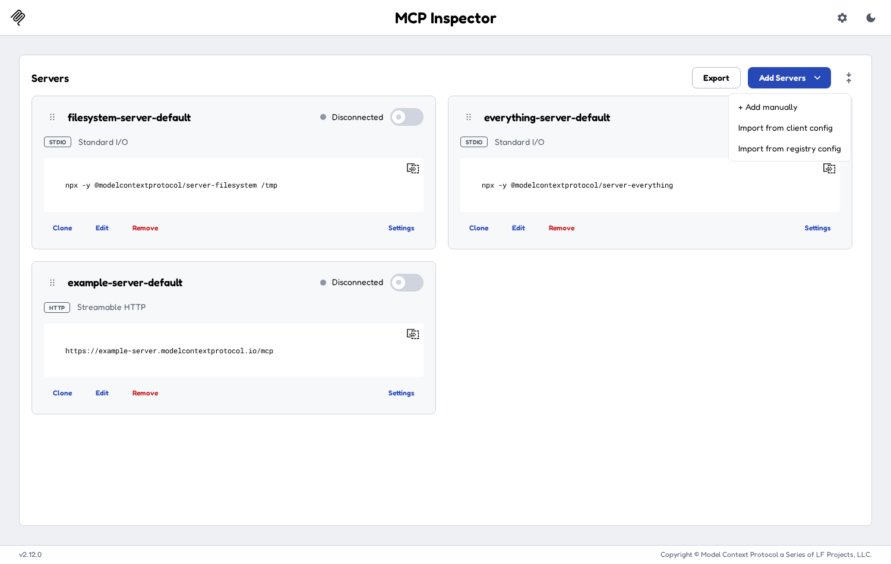

2. In the **Add server** dialog, fill in:
   - **Server ID**: a short name, for example `my-server`. Use only letters, numbers, hyphens and underscores. It becomes the key in `mcp.json`.
   - **Transport**: how the Inspector talks to the server:
     - **streamable-http**: the current standard for remote servers. Use this for most HTTP servers.
     - **sse (Server-Sent Events)**: the older HTTP transport. Use it only if the server still requires it.
     - **stdio (local process)**: the Inspector starts the server as a program on your machine. You then fill in **Command**, **Arguments**, **Environment** and **Working directory** instead of a URL.
   - **URL** (HTTP transports only): the server's full MCP endpoint, including the path, for example `https://example.com/mcp`.
3. Click **Add**. The server appears as a card on the Servers screen.

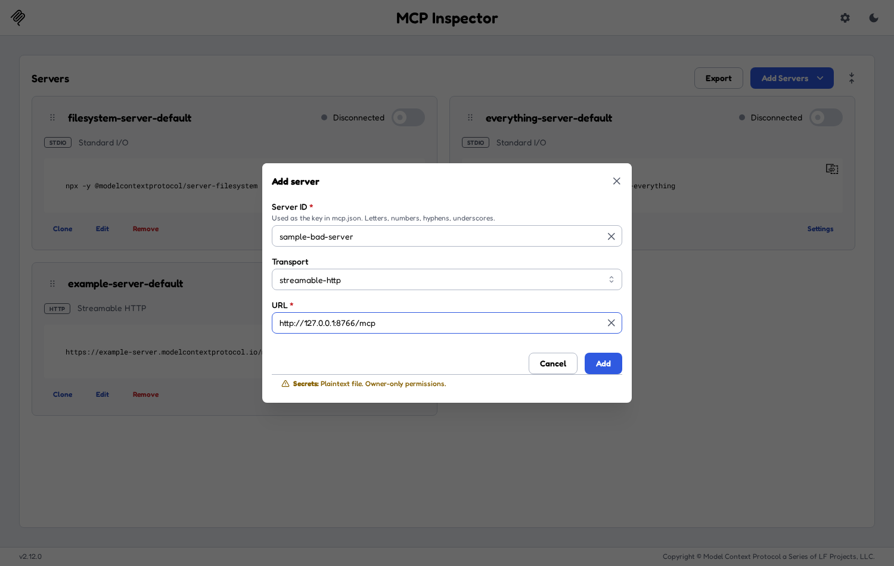

To change a server later, click **Edit** on its card. **Clone** makes a copy and **Remove** deletes it.

## 4. Add an API key or other headers

Many servers want an API key in a header such as `x-api-key` or `Authorization`.

1. On the server's card, click **Settings**. The **Server Settings** dialog opens.
2. Open the **Custom Headers** section.
3. Click **+ Add Header**.
4. In **Key**, type the header name, for example `x-api-key`. In **Value**, paste the key.
5. Close the dialog with the **X** in the top-right corner. There is no Save button: settings are saved as you type.
6. If you are already connected, disconnect and connect again. Header changes take effect on the next connect.

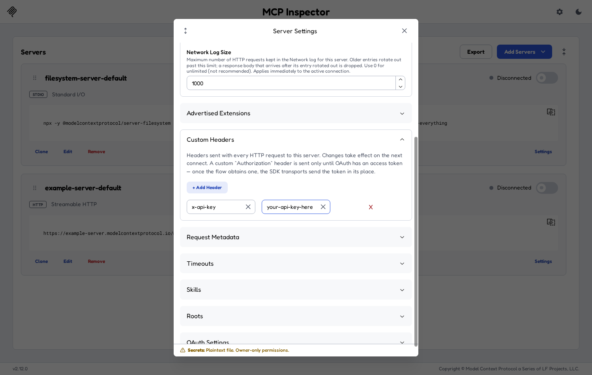

Notes:

- The headers are sent with every HTTP request to this server.
- A custom `Authorization` header is sent only until OAuth gets an access token. After that the OAuth token replaces it.
- For servers that use OAuth sign-in, use the **OAuth Settings** section in the same dialog instead.
- The footer of the dialog tells you where secrets are stored. On a machine without a system keychain it says **Secrets: Plaintext file. Owner-only permissions.** Don't put production keys on a shared machine.

## 5. Connect

1. Turn on the switch at the top-right of the server's card. The label changes from **Disconnected** to **Connected**, and the header shows the connection time.
2. Tabs for the server appear in the top bar. Only the tabs the server supports are shown.
3. A **monitoring sidebar** opens on the right with the **Protocol** log (every JSON-RPC message) and, for HTTP servers, the **Network** log (every HTTP request). Use the **Close monitoring sidebar** button at the top-right to hide it. Protocol and Network then become ordinary tabs.

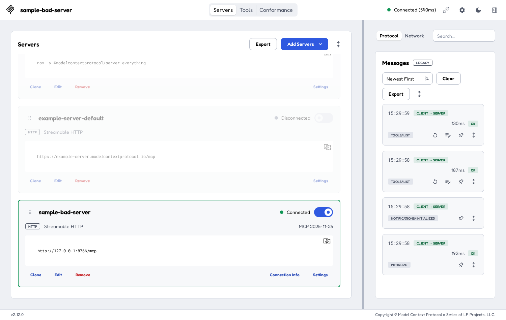

If the label shows **Failed** instead, see [Troubleshooting](#10-troubleshooting).

## 6. The Tools tab

Use the Tools tab to call one tool by hand and look at what comes back.

1. Click **Tools** in the top bar. The left panel lists the tools, for example **Tools (9)**. Type in **Search tools…** to filter the list. Turn on **Paginated** to load the list one page at a time.
2. Click a tool. The right panel shows its name, badges such as **READ-ONLY**, and its description.
3. Fill in the inputs. Required inputs are marked with `*`. Turn on **Edit as JSON** if you'd rather type the arguments as one JSON object.
4. Click **Execute Tool**.

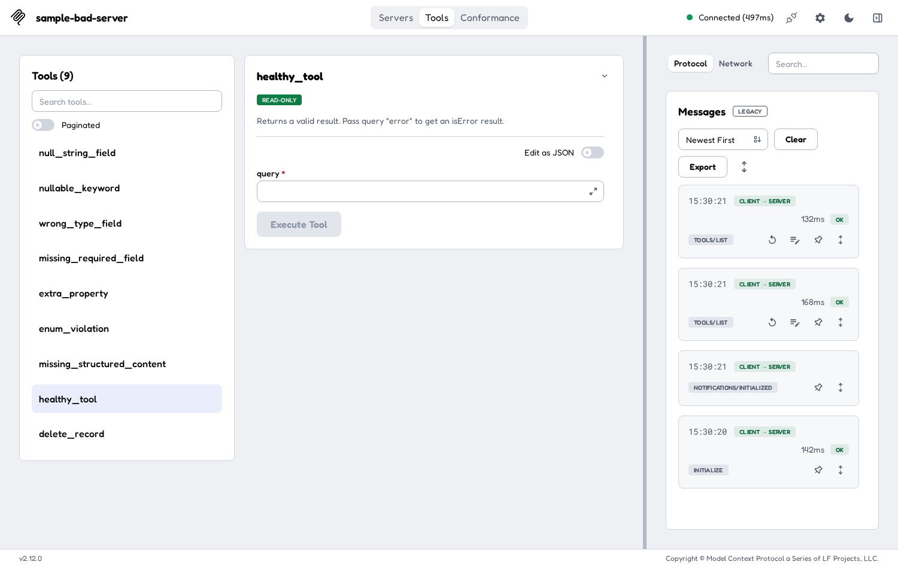

The result replaces the form:

- **Results**: the tool's `content`, which is the text (or images and so on) a person or model would read.
- **Structured Output**: the tool's `structuredContent`, which is the JSON object that programs read. It appears only when the tool returned one. If the tool declares an `outputSchema`, this object must match it.

Click the **X** next to **Results** to go back to the form.

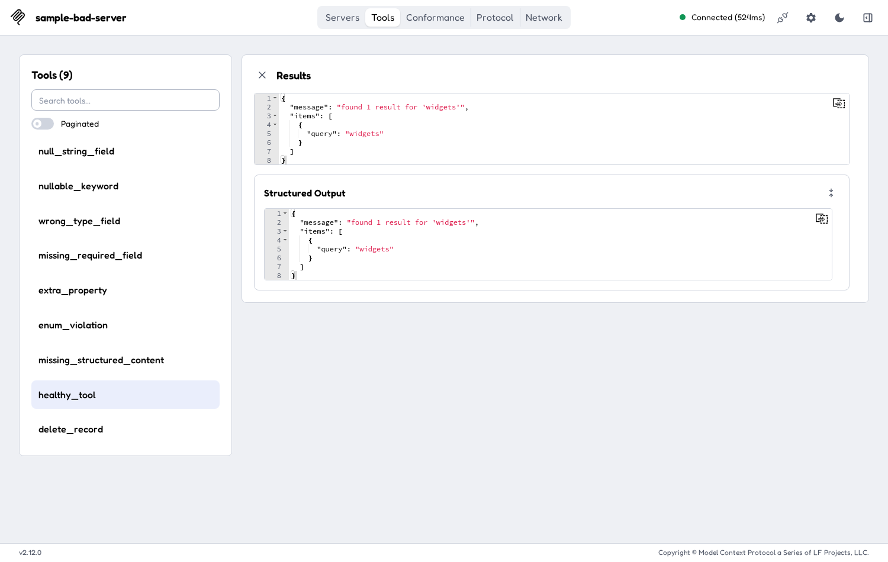

The Tools tab does not show the `outputSchema` itself. To see the schema next to the response, with the problem fields highlighted, use the **Details** dialog in the Conformance tab (section 8.6).

If the result shows **Tool Call Failed / Invalid Parameters (-32602)**, the cause may be the response, not your arguments (see section 1). Run the same tool in the Conformance tab to see the real reason.

## 7. Other tabs

Tabs appear only when the connected server supports them:

| Tab | What it is for |
|---|---|
| **Servers** | Add, edit, clone, remove, connect and configure servers. |
| **Apps** | Open tools that come with an interactive UI (MCP Apps). |
| **Tools** | List and call tools (section 6). |
| **Prompts** | List the server's prompt templates, fill in their arguments and see the messages they produce. |
| **Resources** | Browse and read the files and data the server publishes. |
| **Skills** | Browse skills, if the server offers the skills extension. |
| **Conformance** | Schema and response checks (section 8). Shown when the server has tools. |
| **Tasks** | Follow long-running tasks, if the server supports them. |
| **Logs** | Log messages the server sends, if it supports logging. |
| **Protocol** | Every JSON-RPC message, in both directions. |
| **Network** | Every HTTP request and response (HTTP servers only). |
| **Console** | The server process's error output (stdio servers only). |

## 8. The Conformance tab

Click **Conformance** in the top bar.

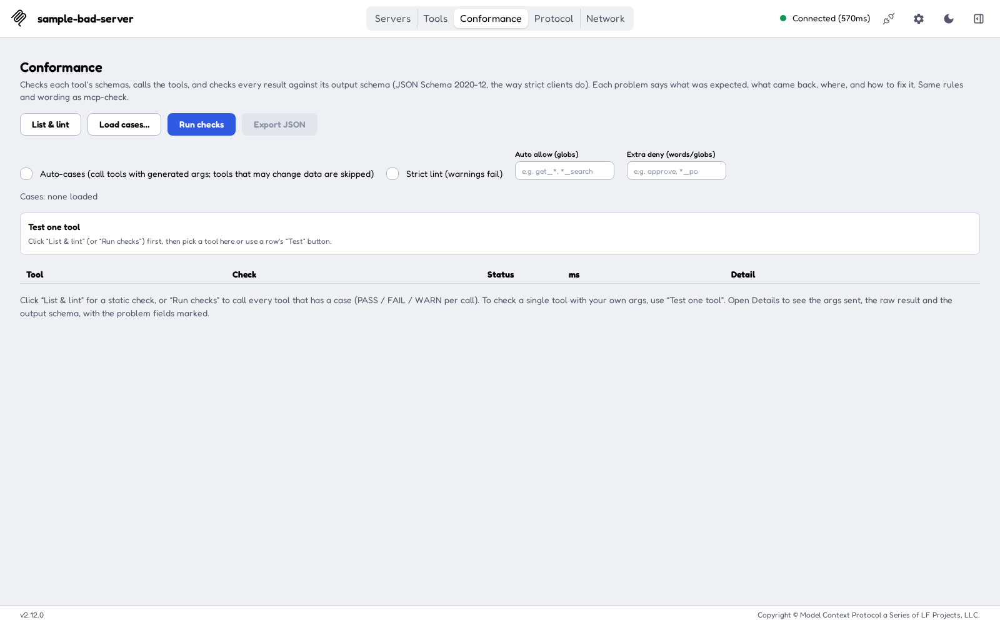

### 8.1 Controls at a glance

| Control | What it does | Calls tools? |
|---|---|---|
| **List & lint** | Runs `tools/list` (all pages) and checks every tool's schemas locally. | **No** |
| **Load cases…** | Loads a cases file (`.yaml`, `.yml` or `.json`) with the arguments to use for chosen tools. | No |
| **Run checks** | Lints every tool, then calls each tool that has a case. If **Auto-cases** is ticked, it also calls tools that have no case, using generated arguments. | **Yes**, if there are cases or Auto-cases is ticked |
| **Export JSON** | Downloads the current results as `conformance-report.json`. | No |
| **Auto-cases (call tools with generated args; tools that may change data are skipped)** | Lets Run checks call tools that have no case. **Off by default.** | (setting) |
| **Strict lint (warnings fail)** | Treats lint warnings as failures. | (setting) |
| **Auto allow (globs)** | Only auto-call tools whose names match, for example `get_*, *_search`. | (setting) |
| **Extra deny (words/globs)** | More names to treat as "may change data", for example `approve, *_po`. | (setting) |
| **Test one tool** | Pick one tool, edit its arguments, and click **Run this tool**. | **Yes**, that one tool |

The line under the checkboxes shows **Cases:** with the loaded file (or `none loaded`), plus what is running right now.

### 8.2 List & lint: the safe first step

**List & lint** only calls `tools/list` and checks the schemas on your machine. It never calls a tool, so it is safe to run against production.

1. Click **List & lint**.
2. Each tool gets one **lint** row. The summary line reads like `tools: 9 | lint: 8 pass, 1 warn, 0 fail | ...`.

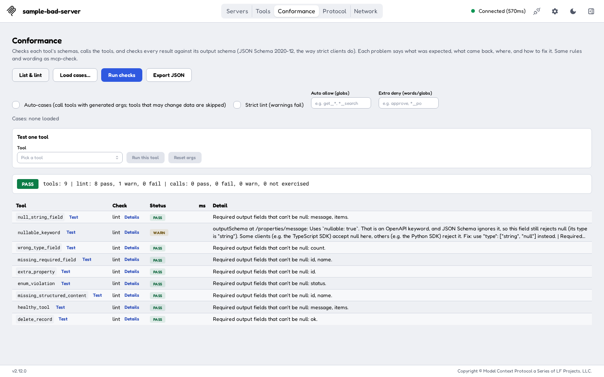

Lint checks:

- Each `inputSchema` and `outputSchema` is valid JSON Schema.
- The root of each schema is `"type": "object"` (MCP requires this).
- No OpenAPI-only keywords are used: `nullable`, `discriminator`, `xml`, `externalDocs` or `example`. These give a **WARN**.
- Tool names are 1–128 characters long and use only `A-Z a-z 0-9 _ - .`.
- Every tool has an input schema.
- For information, it lists the required output fields that can't be null. These are the fields that break when a backend returns `null`.

### 8.3 Run checks with Auto-cases

**Run checks** lints every tool and then calls tools:

- A tool with a case in a loaded cases file is called with those arguments.
- A tool with no case is called only if **Auto-cases** is ticked. Otherwise its row says **Not exercised**: *"Not called: there is no case for it. Turn on auto-cases, or run this tool on its own."*

With Auto-cases on, the Inspector builds the **smallest valid arguments** from each tool's `inputSchema`:

- It fills in **required fields only**. Optional fields are left out.
- For each field it uses the first of these that exists: `const`, `default`, the first `enum` value, the first `examples` value.
- Otherwise it goes by type:
  - **string**: `"test"`, repeated and cut to reach `minLength` if one is set (and never longer than `maxLength`). Known formats get a sample value, for example `2026-01-01` for `date` and `test@example.com` for `email`.
  - **number / integer**: `minimum` if set, otherwise `1` (kept at or below `maximum`).
  - **boolean**: `false`.
  - **array**: `minItems` items (none if `minItems` isn't set).
  - **object**: its required properties, built the same way.
- For `anyOf`/`oneOf` it uses the first option that isn't `null`. Local `$ref`s are followed.
- If the generated arguments would not pass the tool's own `inputSchema`, the tool is not called. The row says why.

**Tools that may change data are never auto-called.** A tool is skipped if:

- its name contains `submit`, `create`, `update`, `delete`, `place`, `order`, `send`, `cancel`, `write` or `post`. The match ignores case and also matches parts of words, so `order_search` is skipped too, on purpose;
- its name matches something you typed in **Extra deny (words/globs)**, for example `approve`;
- the server marks it `destructiveHint: true` or `readOnlyHint: false`; or
- **Auto allow (globs)** is set and the tool doesn't match it.

These rules always beat Auto allow. A skipped tool shows **Not exercised** with the reason, for example *"... auto-cases skips it because its name suggests side effects (contains 'delete')."*

After the run you will see:

- one or more rows per tool: `lint`, then `call[auto]` (generated arguments), `call[0]`, `call[1]`… (cases from a file), or `call[args]` (your own arguments from Test one tool), and a `null-sweep` row if any disallowed `null` was found;
- the **ms** column, which is how long each call took;
- a big **PASS** or **FAIL** badge and the summary line;
- a **coverage** line, for example `coverage: 9 tools, 8 exercised, 1 not exercised (delete_record)`, so a tool that was never called is easy to spot.

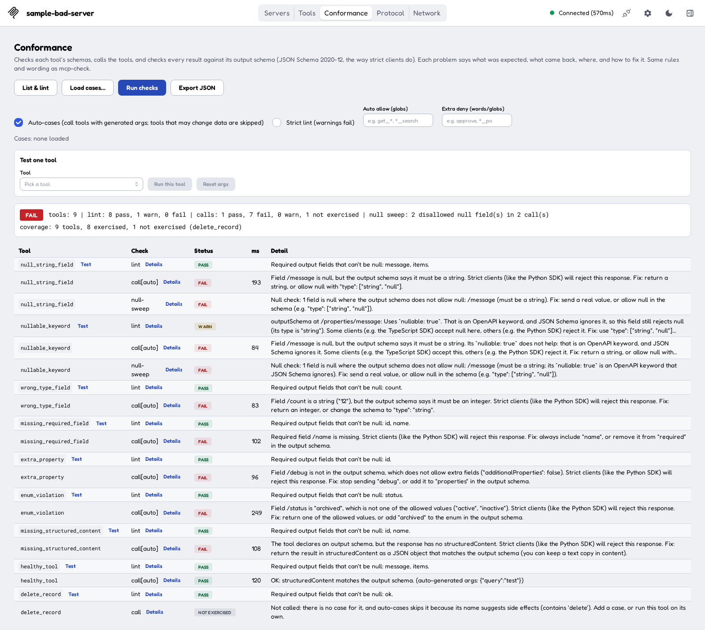

How call results are graded:

| Status | Meaning |
|---|---|
| **PASS** | The call worked and `structuredContent` matches the output schema, or the tool has no output schema. |
| **FAIL** | The response breaks the output schema, `structuredContent` is missing, or a disallowed `null` was found. With your own arguments or a case, an error result also fails unless the case says `expect: error`. |
| **WARN** | With generated arguments, the tool returned an error. Made-up arguments can simply be unrealistic. Add a real case or test it on its own. |
| **Not exercised** | Not called: there was no case, it was skipped as possibly changing data, or you declined to confirm. |

> **On production servers:** keep **Auto-cases** unticked. It is off by default. With Auto-cases off and no cases file loaded, **Run checks** makes no tool calls. A cases file is different: tools listed in it are called even if their names look risky, so list only read-only tools in a cases file. **Test one tool** always calls the tool you pick. Prefer **List & lint** on production, and run calls against a test environment.

### 8.4 Test one tool

Use this to check one tool, with generated or your own arguments.

1. Run **List & lint** (or **Run checks**) first, so the tool list is loaded.
2. Under **Test one tool**, pick a tool in **Tool**, or click the small **Test** button next to the tool's name in any `lint` row.
3. The **Args** box is filled in with the smallest valid arguments. Edit them as you like. They must be a JSON object, for example `{"query": "widgets"}`. **Reset args** puts the generated arguments back.
4. Click **Run this tool**.

The table now shows only that tool, with an **Only <tool name>** badge. If you edited the arguments, the call row is `call[args]` and the call is expected to succeed. If you didn't, the tool's cases from a loaded file are used, or else the generated arguments (`call[auto]`). To go back to the full list, click **List & lint** or **Run checks** again.

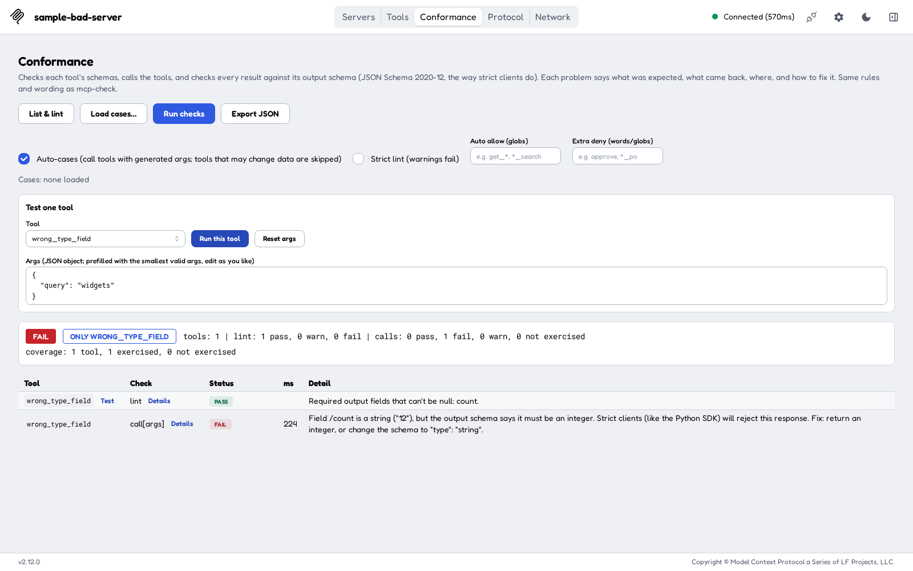

If the tool may change data, an orange note appears: *"Careful: its name suggests side effects (contains 'delete'), so it may change data. You will be asked to confirm before it is called."* When you click **Run this tool**, the browser asks *"Call it anyway with these args?"* If you click **Cancel**, the tool is not called and the row says *"Not called: ... and you did not confirm the call."*

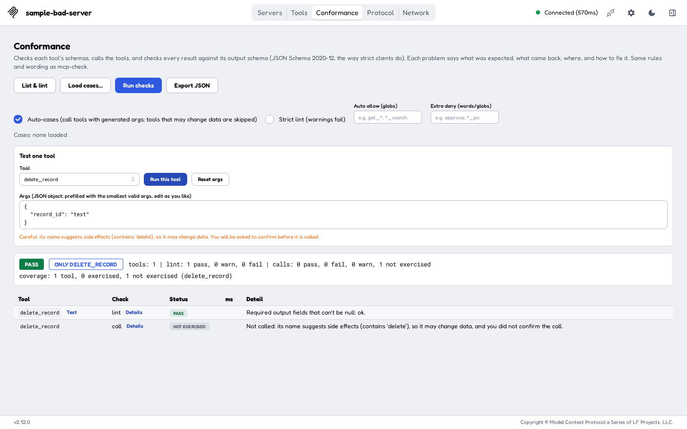

### 8.5 Load a cases file (optional)

A cases file lists realistic arguments for chosen tools, so that **Run checks** can call them with real data. It uses the same format as the `mcp-check` command-line tool:

```yaml
healthy_tool:
  - args: {query: laptop}
  - name: error result
    args: {query: error}
    expect: error
wrong_type_field:
  - args: {query: laptop}
```

- Each key is a tool name, with a list of cases under it.
- `args` holds the tool arguments. `expect` is `success` (the default) or `error`. `name` is an optional label.
- Click **Load cases…** and pick the file. The **Cases:** line shows how many cases and tools were loaded.
- If the file has a case for a tool the server doesn't list, you get a **WARN** row.

### 8.6 The Details dialog

Every row has a **Details** button next to its check name. It opens a large dialog. Close it with **Escape** or the **X**.

For a **lint** row, the dialog shows:

- **Schema findings**: one card per problem, with an **Error** or **Warning** badge, the schema (`inputSchema` or `outputSchema`), the field path and an explanation.
- **Required output fields**: the fields that must be present and can't be null.
- **No output schema**, if the tool has none. Clients then can't validate its results.
- **Schemas**: **Input schema** and **Structured schema (outputSchema)** side by side, with the problem lines highlighted.

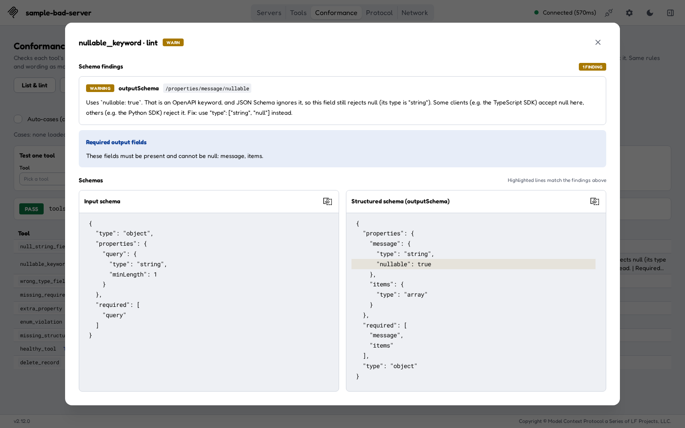

For a **call** row, the dialog shows:

- **Check result**: the full explanation and fix.
- **Args sent**: exactly what was sent to the tool.
- **Response and schema**: the raw **Result** (`content`, `structuredContent`, `isError`) next to the **Structured schema (outputSchema)**. The problem fields are highlighted in both. If the call returned nothing, it says *No result:* and the error.

Each block has a copy button, so you can paste the JSON into a bug report.

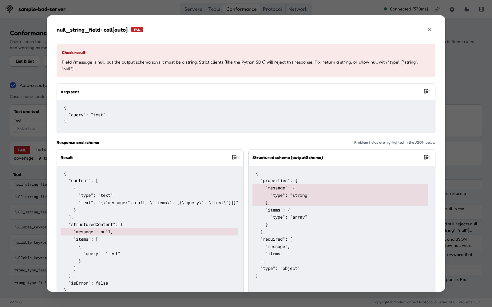

### 8.7 Export the results

Click **Export JSON** to download `conformance-report.json`. It contains the server name and version, the time, whether Auto-cases was on, the cases file name, the overall result (PASS/FAIL), the coverage, every row (including the arguments, the raw result and the schema for call rows), and the full tool list. Attach it to a ticket, or compare it between server versions.

### 8.8 Results stay while you switch tabs

The Conformance tab keeps your loaded cases, settings, chosen tool, edited arguments and results when you switch to another tab and back, as long as you stay on the same connection. A run keeps going while you look at another tab. Connecting again starts a fresh workspace, and so does refreshing the browser page.

### 8.9 What each check catches

| Problem | Example | Where it shows | Result |
|---|---|---|---|
| `null` where the schema doesn't allow it | `"message": null`, schema says `string` | `call` row and a `null-sweep` row (lists **every** disallowed null, at any depth) | FAIL |
| Wrong type | `"count": "12"`, schema says `integer` | `call` row | FAIL |
| Missing required field | `name` is required but missing | `call` row | FAIL |
| Extra property when `additionalProperties: false` | `"debug"` is sent but not in the schema | `call` row | FAIL |
| Value not in the `enum` | `"status": "archived"`, allowed values are `active` and `inactive` | `call` row | FAIL |
| Wrong `const` value | a value other than the exact one required | `call` row | FAIL |
| Missing `structuredContent` | an `outputSchema` is declared but only text comes back | `call` row | FAIL |
| OpenAPI `nullable` in a schema | `{"type": "string", "nullable": true}`. JSON Schema 2020-12 ignores `nullable`, so `null` is still rejected | `lint` row (WARN). A call that returns `null` there also FAILs, noting that some clients accept it and others reject it | WARN / FAIL |
| Other OpenAPI-only keywords | `discriminator`, `xml`, `externalDocs`, `example` | `lint` row | WARN |
| Invalid schema | a schema that isn't valid JSON Schema, a root that isn't `"type": "object"`, or no input schema at all | `lint` row | FAIL |
| Bad tool name | spaces or other characters outside `A-Z a-z 0-9 _ - .`, or longer than 128 characters | `lint` row | WARN |
| Error result with no text | `isError: true` with nothing in `content` | `call` row detail | FAIL or WARN |

All of these are about the **shape** of the data. Whether the values are right is still up to you.

## 9. Try it with the sample server

The companion `mcp-check` project has a small sample server with one tool for each common mistake. It's a quick way to see every check fire.

1. In a second terminal, go to the package's top folder and start the sample server. It needs the `mcp-check` setup from section 2.2:

   ```bash
   cd mcp-check
   .venv/bin/python tests/sample_bad_server.py --port 8766
   ```

   It serves Streamable HTTP at **`http://127.0.0.1:8766/mcp`**. It prints nothing while it waits. Leave it running.

2. In the Inspector, add a server (section 3) with **Server ID** `sample-bad-server`, **Transport** `streamable-http` and **URL** `http://127.0.0.1:8766/mcp`. The sample server needs no key.
3. Connect, open **Conformance**, tick **Auto-cases** and click **Run checks**.

What you should see:

| Tool | What it does wrong | Expected result |
|---|---|---|
| `null_string_field` | returns `"message": null`, but the schema says string | FAIL (call + null-sweep) |
| `nullable_keyword` | the same, but the schema adds OpenAPI `nullable: true` | lint WARN, call FAIL + null-sweep FAIL |
| `wrong_type_field` | returns `"count": "12"` (a string), but the schema says integer | FAIL |
| `missing_required_field` | leaves out the required `name` | FAIL |
| `extra_property` | sends `debug`, but the schema has `additionalProperties: false` | FAIL |
| `enum_violation` | returns `"status": "archived"`, which isn't `active` or `inactive` | FAIL |
| `missing_structured_content` | declares an output schema but returns only text | FAIL |
| `healthy_tool` | nothing: it returns a valid result (query `error` makes it return an error result) | **PASS** |
| `delete_record` | marked destructive, and its name contains `delete` | **Not exercised** (never auto-called) |

The summary should read `tools: 9 | lint: 8 pass, 1 warn, 0 fail | calls: 1 pass, 7 fail, 0 warn, 1 not exercised | null sweep: 2 disallowed null field(s) in 2 call(s)`, followed by `coverage: 9 tools, 8 exercised, 1 not exercised (delete_record)`.

Also try:

- **Test one tool** with `delete_record`, and click **Cancel** at the prompt. It is not called.
- `nullable_keyword` in the **Tools** tab. The stock view accepts the `null`, while the Conformance tab fails it.
- `wrong_type_field` in the **Tools** tab, to see the misleading `-32602 (Invalid params)` message.

The sample server sends `tools/list` in two pages, so pagination gets tested too.

## 10. Troubleshooting

### The Inspector won't start: "Port 6274 is already in use"

Another Inspector (or another program) is using the port.

1. Find it: `lsof -nP -iTCP:6274 -sTCP:LISTEN`.
2. Stop it with `Ctrl+C` in its terminal, or `kill <PID>`.
3. Or run this one on another port: `CLIENT_PORT=6280 MCP_INSPECTOR_API_TOKEN=<your-token> npm run dev`, then open `http://127.0.0.1:6280/?MCP_INSPECTOR_API_TOKEN=<your-token>`. The MCP Apps sandbox uses its own port, 6275. If that one is busy, set `MCP_SANDBOX_PORT` to a free port as well.

### The sample server won't start: "address already in use"

A copy is already running on port 8766. Use it, stop it, or start a new one with `--port 8767` and use `http://127.0.0.1:8767/mcp`.

### The server card shows "Failed"

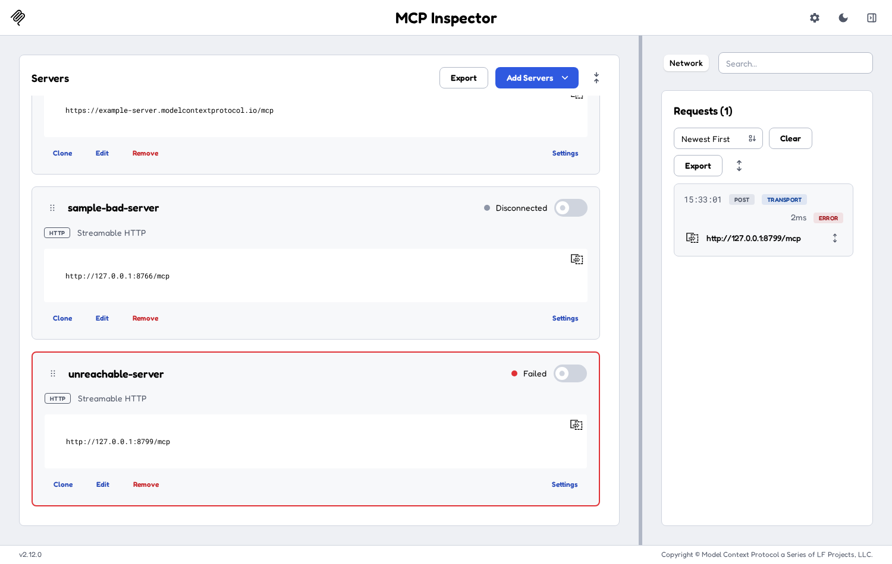

1. Open the **Network** panel and click the failed request to see the error.
2. Check that the server is running and that the **URL** is exactly right, including the path (`/mcp`, `/sse`, …) and `http` versus `https`.
3. Check that the **Transport** matches the server: `streamable-http` for most servers, `sse` for older ones.
4. Fix it with **Edit** on the card, then connect again.

### 401 Unauthorized or 403 Forbidden from the MCP server

The server wants credentials.

1. Add the key under **Settings → Custom Headers** (section 4). Use the exact header name the server expects, for example `x-api-key`, or `Authorization` with the value `Bearer <key>`.
2. Disconnect and connect again. Header changes take effect on the next connect.
3. If the server uses OAuth, set it up under **Settings → OAuth Settings**.
4. In the **Network** panel, open the request and check that the header was sent.

### 401 from the Inspector itself (its local `/api`)

This is about the **Inspector's local token**, not your server's key. It happens when the page and the backend disagree on the token, for example if you restarted the Inspector with a different token and kept an old tab open. Open the address with the new token, or reload the page. The backend puts the current token into the page each time it loads.

### CORS errors

**CORS (Cross-Origin Resource Sharing)** is a browser rule that blocks a web page from calling a server on another origin unless that server allows it. This Inspector sends MCP traffic through its own local backend, so your MCP server normally doesn't need CORS settings. If you do see a CORS or "origin not allowed" error:

- Open the Inspector at the address it printed (`http://127.0.0.1:6274/...`), not through a different host name or a proxy.
- If the error comes from the MCP server's own origin or host checks (some servers have DNS-rebinding protection), allow `127.0.0.1` and `localhost` on the server.

### "Tool Call Failed / Invalid Parameters (-32602)" in the Tools tab

Often this is a **response** problem, not an argument problem (section 1). If the **Protocol** log shows the `tools/call` as OK, run the tool in **Conformance → Test one tool** to see what is wrong with the response.

### Reading Conformance messages

Every message follows the same pattern: **what was found**, **who will reject it**, **how to fix it**. For example:

> Field /count is a string ("12"), but the output schema says it must be an integer. Strict clients (like the Python SDK) will reject this response. Fix: return an integer, or change the schema to "type": "string".

- `/count` is a JSON path inside `structuredContent`. `/items/0/name` means the `name` of the first item.
- *"Strict clients (like the Python SDK) will reject this response"* means the problem will break real clients.
- *"Some clients (e.g. the TypeScript SDK) accept this, others (e.g. the Python SDK) reject it"* means it works in some clients and not in others. This is usually the `nullable` case. Fix it anyway.

Other common messages:

| Message | What it means and what to do |
|---|---|
| `tools/list failed: ...` (red **Error** box) | The connection dropped or the server failed to list its tools. Reconnect and check the Network panel. |
| `Not called: there is no case for it. Turn on auto-cases, or run this tool on its own.` | Expected when Auto-cases is off. |
| `... auto-cases skips it because it could not build valid args (...)` | The input schema is too complex for generated arguments (or has a remote `$ref`). Use **Test one tool** with your own arguments, or add a case. |
| `The call failed for the auto-generated args ...` (WARN) | The server didn't like the made-up arguments. It's not a schema failure. Try real arguments. |
| `The tool reported an error (isError: true). ...` | With your own arguments, the tool returned an error. Check the arguments, or use `expect: error` in a case if the error is intended. |
| `Args are not valid JSON` / `Args must be a JSON object` | Fix the text in the **Args** box. |
| `... The TypeScript SDK rejected it: ...` | The strict check passed but the TypeScript SDK's own check failed. Read the message after the colon. |

## Appendix A: The mcp-check command-line tool

`mcp-check` is a Python command-line tool with the **same rules and the same wording** as the Conformance tab. It connects through the official Python MCP SDK, so it sees exactly what a strict Python client sees. Use it in scripts and CI.

**Setup** (Python 3.10 or newer). This is the same as section 2.2, and `requirements.txt` includes `pytest` for the test suite:

```bash
cd mcp-check
python3 -m venv .venv && . .venv/bin/activate
pip install -r requirements.txt && pip install -e .
python -m pytest -q   # optional: run the test suite
```

**Common commands:**

```bash
export MCP_URL=https://example.com/mcp         # or --url
export MCP_API_KEY=...                         # secret: set it only in the environment
export MCP_AUTH_HEADER=x-api-key               # default: Authorization (sent as "Bearer <key>")

mcp-check --no-calls                           # list + lint only, no tool calls (safe on production)
mcp-check --cases cases.yaml --json out/report.json --junit out/report.junit.xml
mcp-check --auto-cases                         # call read-only tools with generated args
mcp-check --tool healthy_tool --args '{"query": "laptop"}'   # test one tool
mcp-check --auto-cases --show-response         # also print args, raw result and schema for failures
```

Useful options: `--only` and `--skip` (tool names or globs), `--auto-allow` and `--auto-deny` (the same as the two text boxes in the tab), `--confirm-side-effects` (lets `--tool` call a risky tool), `--strict-lint`, `--header 'Name: value'` (non-secret headers), `--sse` (legacy transport) and `--oauth` (browser sign-in instead of a key). The API key is masked as `<SECRET>` in all output.

**Exit codes:** `0` means pass, `1` means at least one FAIL or a connection failure, and `2` means a usage error.

**Against the sample server:**

```bash
.venv/bin/mcp-check --url http://127.0.0.1:8766/mcp --auto-cases
```

The output ends with the same summary and coverage lines as the Conformance tab, then `RESULT: FAIL`.

## Appendix B: Quick reference

| I want to… | Do this |
|---|---|
| Check schemas without calling anything | Conformance → **List & lint** |
| Check responses on a test server | Tick **Auto-cases**, then **Run checks** |
| Check responses with real data | **Load cases…**, then **Run checks** |
| Check one tool | **Test one tool** → pick a tool → edit **Args** → **Run this tool** |
| See why a row failed | **Details** on the row |
| Share results | **Export JSON** |
| Send an API key | Server card → **Settings** → **Custom Headers** → **+ Add Header** |
